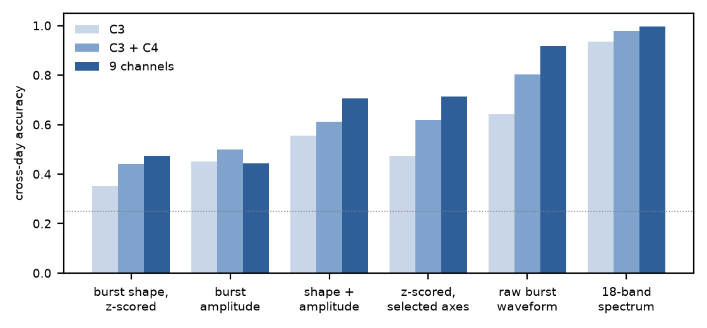

# Beta bursts and EEG person identity

Does the waveform of beta bursts carry information about *who* a person is? Does that information survive artifact rejection? And does it add anything to a standard spectral fingerprint across days?

Tested on the public Zhou2016 motor imagery dataset (4 people, 3 sessions on different days, 9 central channels), using beta burst detection from my master's thesis work and a reimplementation of FAAR, the artifact rejection method of Caillet et al. (arXiv 2605.12408).

## In short

- **Raw burst waveforms identify people far better than z-scored shape.** Cross-day identification rises from 0.47 to 0.92 (chance 0.25). Giving the z-scored waveforms the same axis selection and tuning reaches 0.71, so about 0.2 of the gain comes from keeping the raw waveform, which includes its amplitude. Amplitude alone scores 0.44.
- **A standard spectral fingerprint still does better, and costs far less.** 18 frequency bands beat every burst feature, and adding bursts on top helps little.
- **Artifact rejection keeps identity.** Every method tested beats random removal across days; within a session only FAAR does.
- **My implementation of FAAR** from the paper rejects 13 to 45% of epochs per session, against 2.3% or less reported. The quality curve has no clear knee in my implementation, so this may reflect my choices and not the method.



*Cross-day identification accuracy on Zhou2016 (train sessions 0 and 1, test session 2). Dotted line: chance (0.25).*

Full results, with the controls behind each claim: [RESULTS.md](RESULTS.md).

## Terms

- **Beta burst:** a short event of raised power in the beta band (13 to 30 Hz), found in each channel by threshold.
- **Fingerprint:** a feature set from which a classifier tells people apart. Here the task is to name which of 4 people an epoch came from.
- **Cross-day:** train on sessions 0 and 1, test on session 2, which is a different day.
- **18-band fingerprint:** the covariance of the EEG filtered into 18 bands of 2 Hz from 4 to 40 Hz, mapped to the Riemannian tangent space, then a logistic regression.
- **FAAR:** the artifact rejection method of Caillet et al. It ranks epochs by a quality score and cuts at a knee in the sorted curve.
- **z-scored waveform:** each burst waveform centred and scaled on its own, which removes its amplitude.

## Limits

Four people is a small identification problem, and there is one test session. Burst detection finds about 3.6 bursts per second per channel, so many detected bursts are likely ongoing beta activity, not isolated transients. The analysis windows sit in the motor imagery period. On these channels the imagery effect is in mu (8 to 13 Hz, -11.7%) and not in beta (13 to 30 Hz, -0.2%), so the detected bursts may not be task related. Burst detection takes about 3 hours of CPU per person, against seconds for the filter bank.

## Repository

| Path | What it does |
|---|---|
| `code/detect_zhou.py`, `code/detect_zhou_norej.py` | Burst detection (superlets), with and without the lab's global rejection |
| `code/step12_zhou.py`, `code/step3_zhou_surrogate.py` | Burst shape drift and identity; simpler detector as a check |
| `code/faar_vs_ar_rejection.py` | Global threshold, AutoReject and FAAR per session |
| `code/burst_rates.py`, `code/clean_vs_identity.py` | Rejection vs identity |
| `code/burst_filter_fingerprint.py`, `code/band18_baseline.py` | Burst-filter fingerprint, spectral controls, 18-band baseline |
| `code/amp_shape_identity.py` | Amplitude and raw waveform features |
| `code/plot_superlet_tf.py`, `code/plot_summary.py` | Time-frequency maps; summary figure |
| `code/burst_shape.py` | Shared burst shape helpers |
| `bebopbci/` | Burst detection and preprocessing code from the Bonaiuto lab, which the detection scripts call. Included unmodified apart from one small numpy change (see Credits) |
| `outputs/` | Result tables, logs and figures behind every number |

## Quick start

The detected bursts are not in the repository, because detection takes hours. These two things run from the committed files in seconds:

```
uv sync
uv run python code/plot_summary.py
```

This redraws the summary figure from `outputs/amp_shape/results.csv`. Every result table and figure behind the claims is in `outputs/`.

## Where each finding comes from

| Finding in RESULTS.md | Scripts | Result files |
|---|---|---|
| 1. Burst shape identifies people | `step12_zhou.py`, `step3_zhou_surrogate.py` | `outputs/step1_burst_drift_zhou.png`, `step2_burst_identity_zhou.png`, `step3_zhou_guard_waveforms.png` |
| 2. Rejection keeps identity | `faar_vs_ar_rejection.py`, `clean_vs_identity.py`, `burst_rates.py` | `outputs/clean_vs_identity.csv`, `.log`, `.png`, `burst_rates_rejected_vs_kept.png` |
| 3. FAAR rejection rates | `faar_vs_ar_rejection.py` | `outputs/rejection_rates_zhou.png`, `rejection_masks_zhou.npz` |
| 4. Burst filters vs 18 bands | `burst_filter_fingerprint.py`, `band18_baseline.py` | `outputs/burst_filter_fp/` (`results.csv`, `scramble.csv`, `reverse_flip.csv`, `band18_results.csv`) |
| 5. Amplitude and raw waveforms | `amp_shape_identity.py`, `plot_summary.py` | `outputs/amp_shape/results.csv`, `stack_weights.csv`, `outputs/summary_accuracy.png` |
| 6. Mu versus beta | `plot_superlet_tf.py` | `outputs/superlet_tf.png` |

In `outputs/amp_shape/results.csv`, `model` is the feature family (F0 z-scored shape, F1 shape plus amplitude, F2 and F3 raw waveform with axes chosen by separation or stability, F4 amplitude, F5 and F6 the z-scored controls for F2 and F3, B18 the 18-band fingerprint). `how` is single, stacked or concat. `k` is the number of PCA axes kept and `C` the regularization. `split` is days or within. `acc` is balanced accuracy and `ll` is log-loss.

## Reproduce

Python 3.12, with the versions pinned in `pyproject.toml`. Install with `uv sync`. Plan for about 270 MB for the MOABB download, several GB of derived arrays per person (about 3 GB for person 1), and about 3 hours of CPU per person for burst detection.

Run the scripts from the repository root, in this order.

1. `code/detect_zhou.py` and `code/detect_zhou_norej.py` download Zhou2016 through MOABB and detect bursts (several hours of CPU per person).
2. `code/faar_vs_ar_rejection.py` builds the epoch cache and the rejection masks.
3. `code/step3_zhou_surrogate.py real` builds the cleaned epochs that `amp_shape_identity.py` reads.
4. `code/step12_zhou.py`, `code/burst_rates.py`, `code/clean_vs_identity.py`, `code/burst_filter_fingerprint.py`, `code/band18_baseline.py`, `code/amp_shape_identity.py`, `code/plot_superlet_tf.py`, `code/plot_summary.py`.

## Credits and license

- Dataset: Zhou2016, accessed through [MOABB](https://moabb.neurotechx.com/).
- Burst detection and preprocessing: the needed modules of [bebopbci](https://gitlab.com/sotpapad/bebopbci) (Bonaiuto lab, commit 6362c8c) are included in `bebopbci/`, with one small change for recent numpy described there.
- FAAR: Caillet et al., "From EEG Cleaning to Decoding: The Role of Artifact Rejection in MI-based BCIs", EUSIPCO 2026, arXiv 2605.12408. This repository contains an unofficial reimplementation from the paper's description.

Released under GPL-3.0, because it includes bebopbci (see `LICENSE`).

Author: Divyanshi Agrawal.
